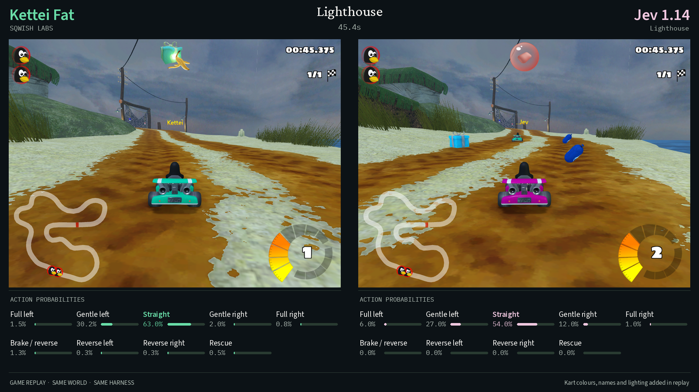

# Kettei Kart

**A decision model, a camera, and nine buttons.** Kettei Fat drives SuperTuxKart through the Sqwish production API. Every decision returns a probability for each control; the highest probability wins.



Two-player capture verifies fixed player-camera identity and the correct projection. The [recorded results](results/README.md) report fresh corrected races and retain the withdrawn initial captures for audit. The preview adds kart colours, names and daylight lighting during verified replay; model inputs remain unchanged.

This repository contains one selected driving harness, its native API adapters, and the tools to record and render a run. Original SuperTuxKart assets and API credentials are not bundled.

## Run it

The tested environment is **Ubuntu 24.04, Python 3.12**, including Ubuntu under **WSL2 with WSLg** on Windows. The simulator requires OpenGL/EGL. Native Windows execution is not supported by these instructions.

```bash
sudo apt-get update
sudo apt-get install -y python3.12-venv libegl1 libgl1 libopengl0 fonts-dejavu-core
git clone https://github.com/sqwishai/kettei-kart.git
cd kettei-kart
python3.12 -m venv .venv
source .venv/bin/activate
python -m pip install -e .

# Enter a Sqwish API key without saving it in shell history.
read -rsp 'Sqwish API key: ' SQWISH_API_KEY; echo
export SQWISH_API_KEY

kettei-kart run --track lighthouse --seed 301 --output runs/lighthouse
kettei-kart render runs/lighthouse --output runs/lighthouse.mp4
```

Get an API key from [Sqwish](https://sqwish.ai). Your account must have access to `kettei-fat`. The first simulator start downloads the official SuperTuxKart assets to its user cache; allow roughly 800 MB for those assets. Keep the repository, cache and run recordings on a local disk with sufficient space.

Try `olivermath` (Oliver's Math Class) or `hacienda` next. The command accepts any racing track installed with the simulator; its track ID selects the game environment and never enters the model prompt. Each command runs a one-lap time trial with Tux. A run stops when the lap finishes or after 300 game seconds. Exit code 0 means a finished lap; exit code 2 means a time limit, interruption or error. Existing output directories are never overwritten.

## What the model sees

The model receives the complete 640 × 480 player camera, including the visible minimap and HUD. Up to three frames cover the present, one second ago and two seconds ago. At the start, only available distinct frames are sent. The prompt also contains six recent controls, a bounded summary of repeated inputs, and concise instructions for steering and ordinary rescue recovery.

Each decision holds one control for **0.2 game seconds**: five steering-and-acceleration choices, brake/reverse, reverse left, reverse right, or a tap of the normal rescue key. The complete descriptions and exact mappings are in [actions.py](src/kettei_kart/actions.py); the complete model prompt is in [observation.py](src/kettei_kart/observation.py).

No coordinates, velocity, track geometry, route labels, depth, hidden opponent state or scripted driving commands enter the model request. The simulator's telemetry is used separately to measure results. Rescue is a normal game action with a time penalty, and its use is recorded.

The simulator pauses while an API call is in flight. The exported video plays at game speed; it does not demonstrate real-time driving throughput. The probability bars show recorded model outputs, not reconstructed reasoning. The camera recording runs at 30 frames per game second, while model decisions occur five times per game second.

## Compare models

The same observation builder, actions and argmax selection work with the native D1 Ultra and Jev image APIs:

```bash
read -rsp 'Liquid API key: ' LIQUID_API_KEY; echo
export LIQUID_API_KEY
kettei-kart run --provider liquid --track lighthouse --seed 301 --output runs/d1-lighthouse

read -rsp 'TypeSafe API key: ' TYPESAFE_API_KEY; echo
export TYPESAFE_API_KEY
kettei-kart run --provider typesafe --track lighthouse --seed 301 --output runs/jev-lighthouse
```

Adapters pin `d1-ultra` and `jev-1.14.0`; a different returned model or fallback is an error. Jev images use its native multipart asset format and image opt-in header. Jev's hundredth-rounded probabilities are normalized only within the maximum possible rounding error. The original scores and their sum are retained; normalization cannot change the winning action or break a tie.

This is a Fat-selected harness applied unchanged to the comparison models. It is not a claim that these settings are optimal for every model. API outputs may vary across calls and future model builds, so identical seeds do not guarantee identical drives. The [recorded results](results/README.md) distinguish selected demonstration runs from fresh matched comparisons.

## Race head to head

With both `SQWISH_API_KEY` and `TYPESAFE_API_KEY` set:

```bash
sudo apt-get install -y g++ git
python -m kettei_kart.native_camera
kettei-kart duel --track lighthouse --seed 501 --output runs/duel-first
kettei-kart duel --track lighthouse --seed 501 --swap --output runs/duel-swapped
kettei-kart render-duel runs/duel-first --detail --daylight --output runs/duel-first.mp4
```

This starts one two-player race with two identical Tux karts, collisions, separate player cameras and a shared simulation clock. Each model receives only its own view and control history. Both choose before the game advances; the slower API response does not grant either kart extra game time. The first completed lap wins, and the race continues until both finish or the game-time limit is reached. The result records both engine finish times and their difference in seconds. If one player reaches the cap, its finish time and the gap remain unavailable. A time limit without a finisher produces no winner.

Two-player capture requires the native camera bridge built above. It binds each camera to its player and matches the projection to the full image aspect ratio. Every capture checks both properties and fails closed if either changes. These checks protect camera wiring; they never enter model observations or select controls. The manifest records the bridge source, engine commit and compiled binary.

After a player finishes, its API calls stop. Both traces continue at the same cadence, but finished-player rows explicitly contain `decision_made: false`, neutral controls and no probabilities. The ordinary game post-finish behavior can continue while the other player races. Driving metrics exclude these post-finish rows.

The race prompt adds opponent awareness and general guidance about anticipating bends, braking before an unavoidable collision, and reorienting after a rescue. Both models receive exactly the same rules, nine controls and history format. These instructions contain no track-specific routes or landmarks; the complete race guidance is in [duel.py](src/kettei_kart/duel.py).

Run both grid assignments when comparing models. A single race can favor one starting slot, and a single track cannot establish overall driving strength. The combined request rate for both players is bounded by `--rate`.

The paired recorder saves both views at the decision cadence. `render-duel` replays their recorded controls at 30 fps and adds compact native **Kettei** and **Jev** labels above the karts, with mint-green and pink paint respectively. Names and colours follow model identity when grid slots are swapped. These additions appear only in the replay and do not alter model inputs. It checks both karts' location, distance and finish status against the original trace after every decision, makes no API calls and stops if the simulation diverges. The video identifies these names as replay additions; original model observations remain available in the trace. Use `--original-cameras` to render those original views at 5 fps instead.

## Recordings and limits

For presentation, `--detail` renders the replay at 1280 × 960 with higher-detail
textures and lighting, keeping the same 4:3 camera proportions. `--daylight` lifts
the native lighting and disables fog after the original scene has loaded. Neither
option changes model inputs, track objects or controls. The replay still checks
the original physics trace after every control interval and stops on divergence.

After the first finish, playback speeds up to 12×, then returns to normal for the
second driver's final approach. The multiplier is shown on screen. Use
`--finish-speed 1` for uninterrupted game-speed playback. The finished driver's
panel holds its finish-line view and displays its measured finish time. Both
finish times and their difference are reported in seconds; a distance lead is
never converted into an estimated time gap.

An optional [camera introduction](cinematics/README.md) films the drivers from the front,
then moves the camera 180 degrees into the driving view. It uses a separate daylight scene,
keeps the karts facing down the track and makes no API calls. The introduction is presentation
footage; the race itself uses recorded model decisions and verified replays.

Each solo run contains `manifest.json`, `summary.json`, `decisions.jsonl`, exact JPEG observations, `final.jpg`, and a clean `camera.mp4`. A duel stores separate traces and cameras per provider, plus a shared `result.json`. The trace records the prompt, action descriptions, probabilities, own controls, request timings and image hashes. Engine measurements live in the explicitly separate `evaluator` field. These files let you inspect exactly what was shown and selected at any point.

Speed durations are estimates from the equally spaced decision samples. Low speed means absolute speed below 5 m/s; nearly stationary means below 1 m/s. Reports include both seconds and fractions, distinguish slow movement from near-stops, and identify near-stop sequences lasting at least one game second. Slowing for a bend can be useful: these measurements explain the result rather than define a score to minimize. Rescue counts are button presses, which can include repeated requests during one animation. Completed laps, game-time limits and API failures remain distinct outcomes.

Reported game durations count controlled simulation ticks from the first model decision, after a fixed countdown. The game HUD uses its own race clock, so its displayed time can differ by the initial idle interval. API waiting time is excluded from both. The raw trace retains request timing for analysis; video overlays focus on the game and action probabilities.

Requests default to a maximum of **1.5 per second**, including retries. `--rate` can increase this up to 7.5 when your account permits it. Run one process at a time unless you implement a shared limiter: separate processes do not share a rate budget. `--max-attempts` and `--wall-seconds` bound a run. Place a file named `STOP` inside its output directory to stop between decisions, or interrupt the process. A request in flight may finish first.

JPEG quality 90 preserves visual detail. Large Sqwish JSON requests use gzip level 1 only when it saves at least 5%. Retries reuse the same request bytes and paused game state. Authentication, schema and model-identity failures stop immediately; transient failures receive at most two retries. `--no-video` reduces recording work without changing the observation policy.

## Develop

```bash
python -m pip install -e '.[dev]'
pytest -q
ruff check .
ruff format --check .
```

The small modules separate controls, observations, provider transport, simulation, recording and presentation. Unit tests cover image-history spacing, the observation boundary, control duration, rescue tapping, native request formats, probability validation, retry identity and fail-closed authentication/model checks. An integration test varies track identity, seed and scoring telemetry while holding the player image constant, and checks that the model observation stays identical. Tests make no paid API calls.

Each CLI invocation owns one simulator. When calling the Python functions from a batch driver, use a fresh process for each race or replay. The native graphics runtime cannot safely initialize twice after cleanup; the wrapper rejects reuse before entering native code.

With camera support built and game assets cached, run the optional native checks:

```bash
KART_NATIVE_TESTS=1 pytest -q tests/test_native_capture.py
```

These checks exercise player-camera identity through overtakes and rescue on all
three demonstration tracks, reject an intentionally incorrect projection, and
compare original versus styled replay physics. They make no model API calls.

## Credits and license

Harness code is Apache-2.0. The native camera bridge is GPL-3.0-or-later, as marked in its source and accompanying license. [SuperTuxKart](https://supertuxkart.net/) and [PySuperTuxKart2](https://github.com/bpiwowar/pystk2) are independent projects with their own licenses. SuperTuxKart code is GPL-3.0-or-later; its game assets carry their individual licenses. This repository distributes neither the engine nor its original assets. Game footage is captured from SuperTuxKart. See [NOTICE](NOTICE).
